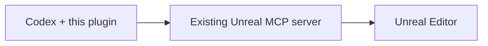

# unreal-engine-skills-for-codex-plugin

**Epic's Unreal Engine workflows, adapted for Codex.**

[](LICENSE)


An **unofficial Codex adaptation** of [Epic Games' Unreal Engine Skills for Claude Code](https://github.com/EpicGames/unreal-engine-skills-for-claude-code-plugin). It brings Epic's MCP workflow guidance to Codex: discover the right tools, read project skills, operate the editor, and handle connection recovery.

The original workflow foundation comes from Epic Games. Codex packaging, instructions, and Windows startup integration were adapted by [Oleg Soroko](https://github.com/Oleg-Soroko). This is a community project, not an official Epic Games or OpenAI release.



## Features

- **Codex plugin packaging** with an automatically selected `unreal-mcp` skill.
- **Native tool discovery:** `list_toolsets` → `describe_toolset` → `call_tool`.
- **Project-aware guidance:** loads applicable Agent Skills exposed by Unreal.
- **Editor workflows** for actors, Blueprints, materials, Niagara, Sequencer, widgets, and other installed toolsets.
- **Recovery guidance** for editor restarts, stale catalogs, compilation, and timed-out operations.
- **Optional Windows startup hook** that detects Unreal workspaces without Git Bash.

All editor actions are supplied by your existing Unreal MCP server and its enabled toolsets. This package runs on the Codex side; it does not install an Unreal plugin or start another MCP server.

## Requirements

- Codex with local plugin support. Installation was tested with Codex CLI `0.141.0`.
- Unreal Editor with `ModelContextProtocol` and `AllToolsets` enabled, or the individual toolsets you need.
- A running Unreal MCP endpoint. The package defaults to `http://127.0.0.1:8000/mcp`.
- Windows and Python 3.11+ for the optional startup hook. Other platforms have not been tested for this adaptation.

## Getting started

Download this repository as a ZIP and extract it, or clone it:

```powershell
git clone https://github.com/Oleg-Soroko/unreal-engine-skills-for-codex-plugin.git
cd unreal-engine-skills-for-codex-plugin
```

From the repository root, install the plugin:

```powershell
codex plugin marketplace add .
codex plugin add unreal-engine-skills-for-codex@unreal-engine-skills
```

Restart Codex so the desktop app loads the plugin and its MCP tools. Keep the downloaded or cloned repository folder available: it is the local marketplace source used for future refreshes.

If your endpoint uses a different port or path, update the `url` in the plugin's [`.mcp.json`](plugins/unreal-engine-skills-for-codex/.mcp.json) before installation. If another Codex connection already targets the same server, choose one active route in your MCP configuration.

Start your existing Unreal MCP server if it is stopped. The Unreal Editor console command is:

```text
ModelContextProtocol.StartServer
```

Codex reviews executable hooks separately. Review and trust the optional SessionStart hook if you want its automatic project context. The main skill and MCP tools work without executing the hook.

## Usage and controls

Invoke `$unreal-mcp`, or describe the Unreal editor task normally. Start with a read-only request:

> Use $unreal-mcp to inspect the connected Unreal Editor and list its available toolsets.

Then ask for a concrete editor task, for example:

> Inspect the selected Blueprint and explain its variables.

> Find material assets matching this description and show the candidates.

Enable or disable **Unreal Engine Skills for Codex** in Codex's plugin list. To remove the plugin:

```powershell
codex plugin remove unreal-engine-skills-for-codex@unreal-engine-skills
```

## What changed from upstream

| Area | Codex adaptation |
| --- | --- |
| Package | Codex manifest and local marketplace catalog |
| Instructions | Codex-specific configuration, tool dispatch, and recovery guidance |
| Startup context | Optional Python hook launched through Windows PowerShell |
| Connection | HTTP client configuration for the existing native Unreal MCP server |
| Optional bridges | Generic request-tracking guidance for an explicitly selected existing bridge |

This is an adaptation, not a claim of identical behavior across agents. Verified on Unreal **5.8.3**: plugin installation and enabling, Codex skill and MCP discovery, native toolset discovery, and a successful read-only project-skill query. Individual asset-editing workflows have not been exhaustively tested.

## Credits and license

- **Original:** [Unreal Engine Skills for Claude Code by Epic Games](https://github.com/EpicGames/unreal-engine-skills-for-claude-code-plugin).
- **Source baseline:** upstream `3.1.1`, commit [`a6aa73a`](https://github.com/EpicGames/unreal-engine-skills-for-claude-code-plugin/commit/a6aa73ada02a9fb1f5415bec491f9942c519b297).
- **Codex adaptation:** [Oleg Soroko](https://github.com/Oleg-Soroko).
- **License:** [MIT](LICENSE). Epic Games' original copyright and license notice are preserved. See [UPSTREAM.json](UPSTREAM.json) for provenance.
